# Evaluationsbericht – TrashNet-Abfallsortierung

*Erstellt am 15.11.2026 11:30*

## 1. Überblick

Untersucht wurde ein trainiertes ResNet50-Modell für die Bildklassifikation von Abfall. Die Evaluation verwendet ausschließlich den vorgegebenen Testsplit. Ein erneutes Training fand nicht statt.

| Eigenschaft | Wert |
| --- | --- |
| Modell | ResNet50 |
| Testbilder | 384 |
| Klassen | cardboard, glass, metal, paper, plastic, trash |
| Testsplit | Unverändert übernommen |
| Confidence Threshold | 80 % – Nutzerentscheidung |
| Messumgebung | Google Colab – CPU |

### Relevanz für die Abfallsortierung

| Metrik | Relevanz | Begründung |
| --- | --- | --- |
| Recall pro Klasse | **Sehr hoch** | Zeigt übersehene Materialien. |
| Precision pro Klasse | **Sehr hoch** | Zeigt falsch zugeordnete Materialien. |
| Confusion Matrix | **Sehr hoch** | Zeigt Verwechslungen zwischen Klassen. |
| Ablehnungsrate | **Sehr hoch** | Zeigt nicht automatisch zuordenbare Bilder. |
| Accuracy akzeptierter Bilder | **Sehr hoch** | Beschreibt die Qualität akzeptierter Entscheidungen. |
| Latenz und FPS | **Sehr hoch** | Relevant für spätere Edge-Integration. |
| F1 und Macro-F1 | **Hoch** | Kombinieren Precision und Recall. |
| Grad-CAM | **Hoch** | Unterstützt die Analyse von Modellentscheidungen. |
| Gesamt-Accuracy | **Mittel** | Kann klassenbezogene Fehler verdecken. |
| Bootstrap-Intervall | **Ergänzend** | Beschreibt statistische Unsicherheit. |

## 2. Testdatensatz

Der Testsplit wurde vor dem Training festgelegt und in dieser Evaluation weder verändert noch methodisch neu bewertet.

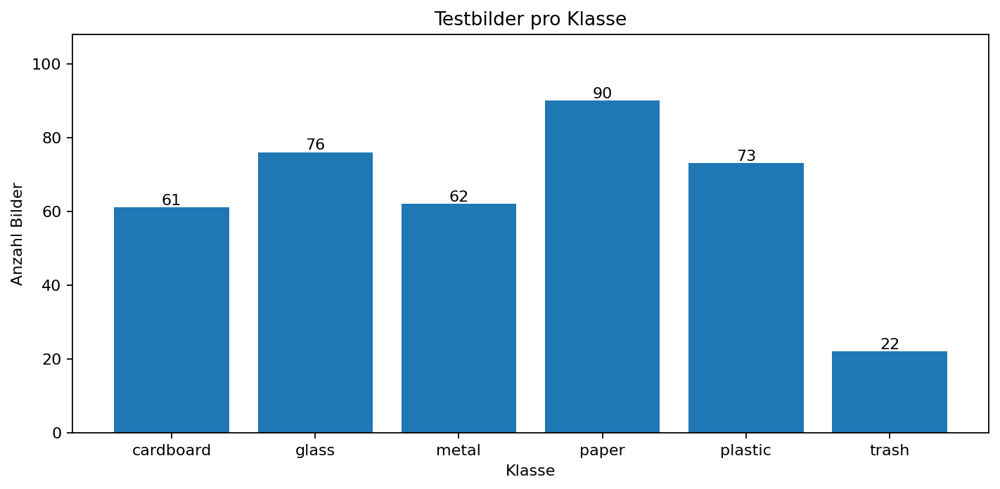

## 3. Klassifikationsmetriken

### Berechnungsformeln

**Accuracy:** `(Anzahl richtiger Vorhersagen) / (Anzahl aller Bilder)`

**Precision:** `TP / (TP + FP)`

**Recall:** `TP / (TP + FN)`

**F1:** `2 × Precision × Recall / (Precision + Recall)`

**Macro-F1:** `Summe der F1-Werte aller Klassen / Anzahl Klassen`

**Weighted-F1:** `Summe(F1 je Klasse × Support je Klasse) / Gesamtzahl Bilder`

TP bezeichnet richtig positive, FP falsch positive und FN falsch negative Zuordnungen. Die Berechnung erfolgt für jede Klasse nach dem One-vs-Rest-Prinzip.

| Kennzahl | Ergebnis |
| --- | --- |
| **Accuracy** | 85.42 % |
| Macro-Precision | 85.73 % |
| Macro-Recall | 81.34 % |
| **Macro-F1** | 82.63 % |
| Weighted-F1 | 85.23 % |
| Richtige Vorhersagen | 328 / 384 |

### Metriken pro Klasse

| Klasse | Bilder | Precision | Recall | F1 |
| --- | --- | --- | --- | --- |
| cardboard | 61 | 97.83 % | 73.77 % | 84.11 % |
| glass | 76 | 86.84 % | 86.84 % | 86.84 % |
| metal | 62 | 79.73 % | 95.16 % | 86.76 % |
| paper | 90 | 78.18 % | 95.56 % | 86.00 % |
| plastic | 73 | 96.77 % | 82.19 % | 88.89 % |
| trash | 22 | 75.00 % | 54.55 % | 63.16 % |

### Confusion Matrix

Die Zeilen zeigen die tatsächliche Klasse, die Spalten die vorhergesagte Klasse. Einträge außerhalb der Hauptdiagonale stellen Fehlklassifikationen dar.

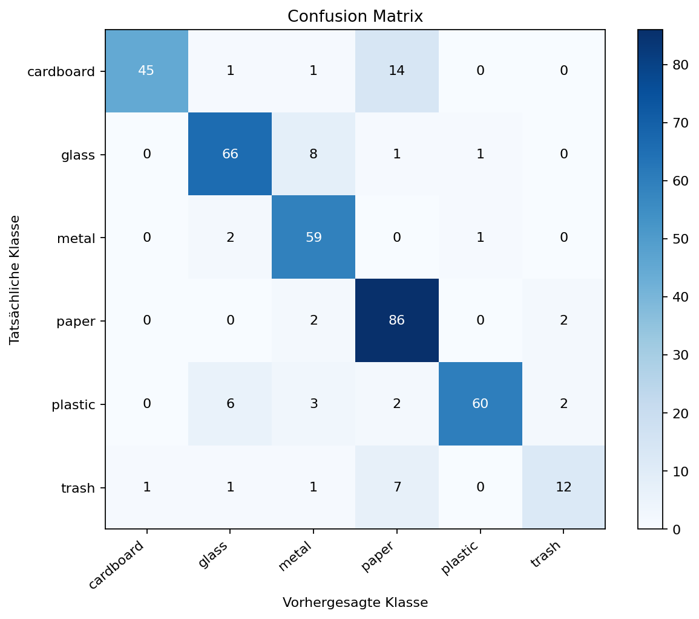

## 4. Unsicherheit und Ablehnungsrate

**Nutzerentscheidung:** Der Threshold wurde fiktiv auf 80 % festgelegt. Es erfolgte keine nachträgliche Optimierung.

**Konfidenz:** `max(softmax(Modellausgabe))`

**Ablehnungsrate:** `Anzahl Vorhersagen mit Konfidenz < 0.80 / Anzahl aller Bilder`

**Akzeptanzrate:** `Anzahl Vorhersagen mit Konfidenz >= 0.80 / Anzahl aller Bilder`

**Accuracy akzeptierter Fälle:** `Richtige akzeptierte Vorhersagen / Alle akzeptierten Vorhersagen`

Softmax-Werte sind ohne gesonderte Kalibrierungsprüfung nicht automatisch zuverlässige Wahrscheinlichkeiten.

| Kennzahl | Ergebnis |
| --- | --- |
| **Unsicherheitsrate** | 44.53 % |
| Abgelehnte Bilder | 171 |
| Akzeptierte Bilder | 213 |
| Akzeptanzrate | 55.47 % |
| **Accuracy akzeptierter Fälle** | 98.59 % |
| Richtige akzeptierte Fälle | 210 |
| Falsche akzeptierte Fälle | 3 |

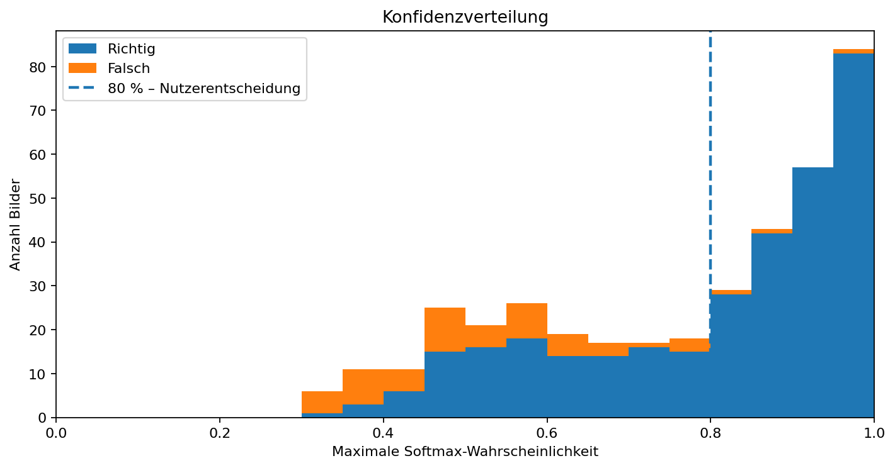

### Ablehnung pro Klasse

**Formel:** `Abgelehnte Bilder einer tatsächlichen Klasse / Alle Testbilder dieser Klasse`

| Klasse | Ablehnungsrate | Akzeptierte Bilder | Accuracy akzeptiert |
| --- | --- | --- | --- |
| cardboard | 40.98 % | 36 | 94.44 % |
| glass | 52.63 % | 36 | 100.00 % |
| metal | 50.00 % | 31 | 100.00 % |
| paper | 23.33 % | 69 | 100.00 % |
| plastic | 52.05 % | 35 | 100.00 % |
| trash | 72.73 % | 6 | 83.33 % |

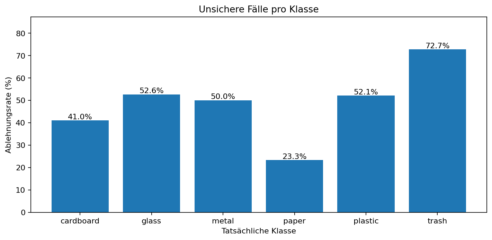

## 5. Laufzeit und Modellgröße

**Messumgebung:** Google Colab – CPU

Alle Messungen erfolgen auf Google Colab und nicht auf einem tatsächlichen Edge-Gerät.

**Mittlere Latenz:** `Summe der Einzelbildzeiten / Anzahl Messungen`

**Median:** Mittlerer Wert der sortierten Messungen.

**P95:** Empirisches 95. Perzentil der Einzelbildmessungen.

**Rechnerischer Einzelbilddurchsatz:** `1000 / mittlere Latenz in ms`

**Batch-FPS:** `Verarbeitete Bilder / Summe der Batch-Inferenzzeiten in Sekunden`

**Modellgröße (MiB):** `Checkpoint-Dateigröße in Bytes / 1048576`

| Messgröße | Messwert |
| --- | --- |
| Mittlere Einzelbildlatenz | 218.21 ms |
| Median | 218.54 ms |
| P95 | 238.38 ms |
| Maximum | 252.19 ms |
| Anzahl Messungen | 40 |
| Einzelbild-FPS | 4.58 |
| Batch-FPS | 3.15 |
| Batchgröße | 32 |
| Checkpointgröße | 90.03 MiB |
| Modellparameter | 23520326 |

Die Einzelbildmessung enthält Dateiladen, Dekodierung, Vorverarbeitung, Gerätetransfer, Modellinferenz und Rücktransfer der Vorhersage. Kamera, Netzwerk und Sortiermechanik fehlen.

**Es erfolgt keine Bewertung der Edge-Tauglichkeit.**

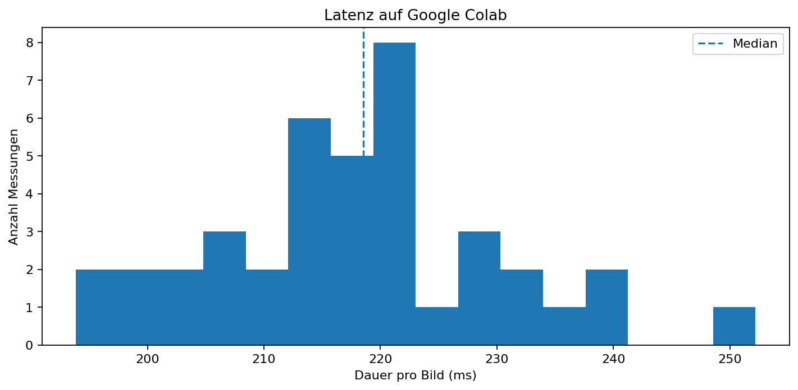

## 6. Fehlklassifikationen

Es wurden 56 Bilder falsch klassifiziert.

Die Beispiele sind nach absteigender Konfidenz sortiert und stellen keine repräsentative Zufallsstichprobe dar.

| Bild | Tatsächlich | Vorhersage | Konfidenz | 80-%-Regel |
| --- | --- | --- | --- | --- |
| 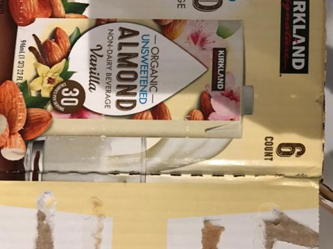 | cardboard | paper | 95.29 % | Akzeptiert |
|  | cardboard | paper | 89.07 % | Akzeptiert |
|  | trash | paper | 80.80 % | Akzeptiert |
| 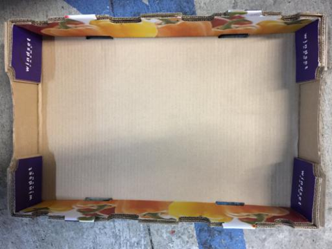 | cardboard | paper | 77.94 % | Abgelehnt |
| 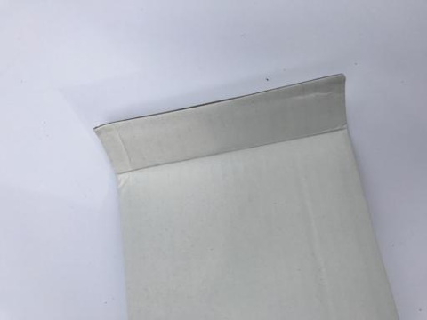 | cardboard | paper | 77.35 % | Abgelehnt |
| 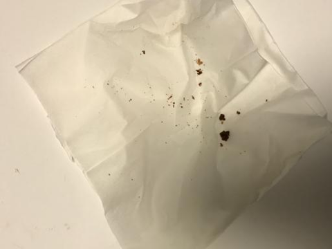 | trash | paper | 75.97 % | Abgelehnt |
| 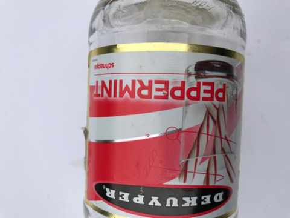 | glass | metal | 71.22 % | Abgelehnt |
| 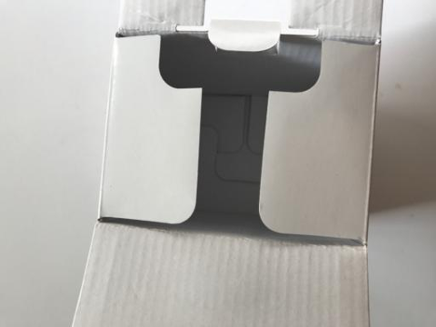 | cardboard | paper | 67.44 % | Abgelehnt |
| 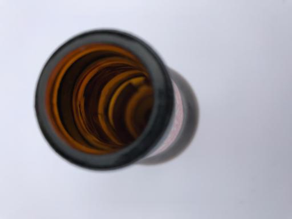 | glass | metal | 67.03 % | Abgelehnt |
| 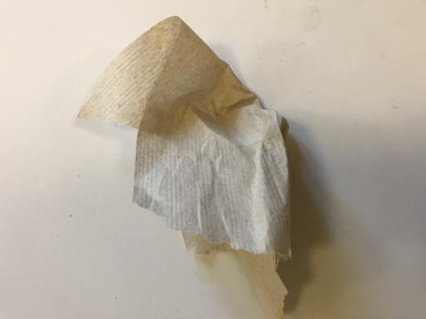 | trash | paper | 65.13 % | Abgelehnt |
| 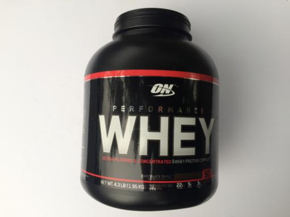 | plastic | glass | 64.40 % | Abgelehnt |
| 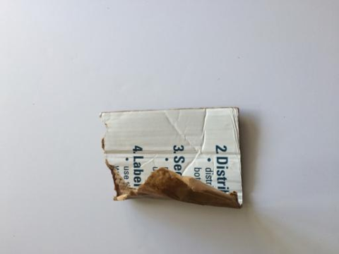 | cardboard | paper | 63.50 % | Abgelehnt |
| 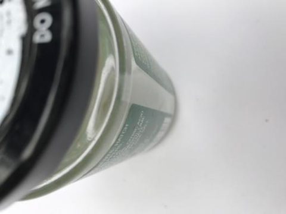 | glass | metal | 62.35 % | Abgelehnt |
| 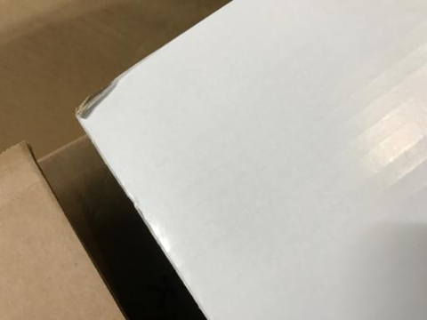 | cardboard | paper | 61.28 % | Abgelehnt |
| 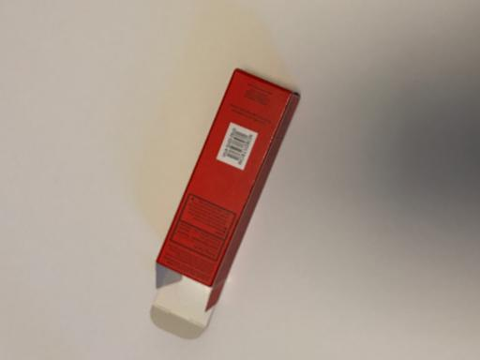 | paper | trash | 60.08 % | Abgelehnt |
| 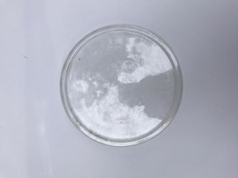 | plastic | glass | 59.96 % | Abgelehnt |
| 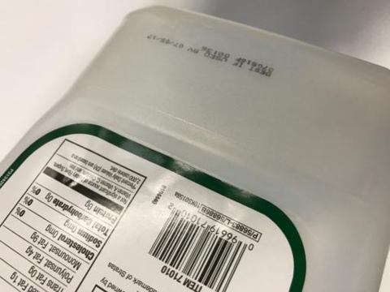 | plastic | paper | 58.81 % | Abgelehnt |
| 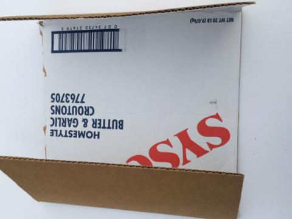 | cardboard | paper | 58.63 % | Abgelehnt |

## 7. Grad-CAM

Grad-CAM visualisiert Bildbereiche, deren Merkmale den dargestellten Klassenscore beeinflussen. Warme Farben zeigen höhere Beiträge.

**Einschränkung:** Grad-CAM ist eine Interpretationshilfe und liefert keinen kausalen Nachweis für Shortcut-Learning.

**Tatsächlich:** metal · **Vorhersage:** metal · **Konfidenz:** 66.02 % · **Ergebnis:** Richtig

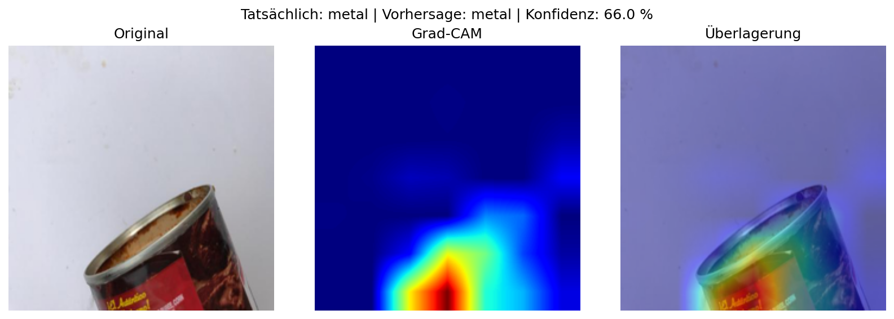

**Tatsächlich:** cardboard · **Vorhersage:** cardboard · **Konfidenz:** 98.40 % · **Ergebnis:** Richtig

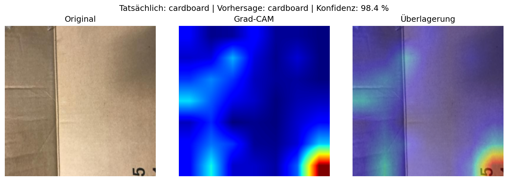

**Tatsächlich:** paper · **Vorhersage:** paper · **Konfidenz:** 97.69 % · **Ergebnis:** Richtig

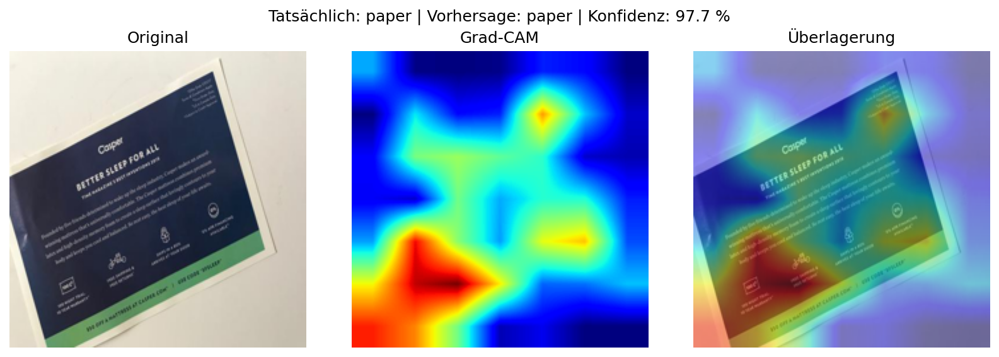

**Tatsächlich:** paper · **Vorhersage:** paper · **Konfidenz:** 92.56 % · **Ergebnis:** Richtig

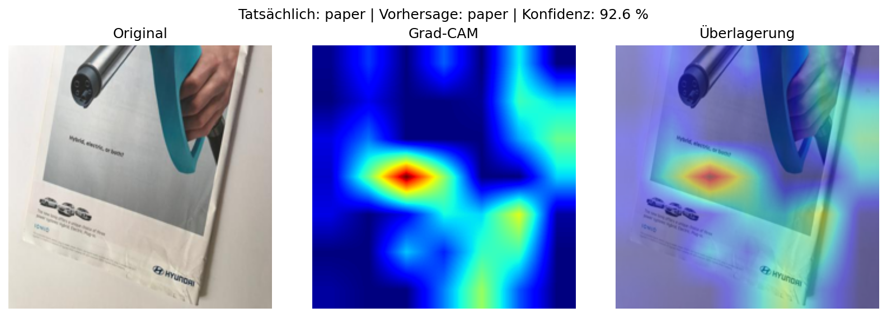

**Tatsächlich:** plastic · **Vorhersage:** glass · **Konfidenz:** 47.81 % · **Ergebnis:** Falsch

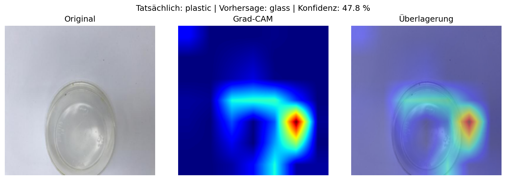

**Tatsächlich:** cardboard · **Vorhersage:** paper · **Konfidenz:** 67.44 % · **Ergebnis:** Falsch

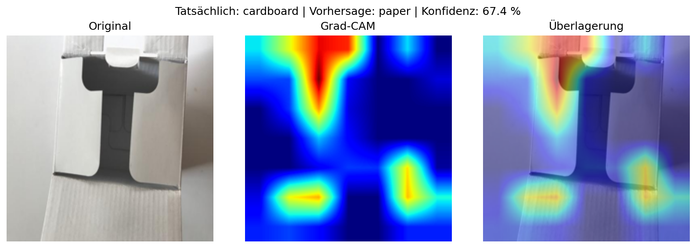

**Tatsächlich:** cardboard · **Vorhersage:** paper · **Konfidenz:** 52.97 % · **Ergebnis:** Falsch

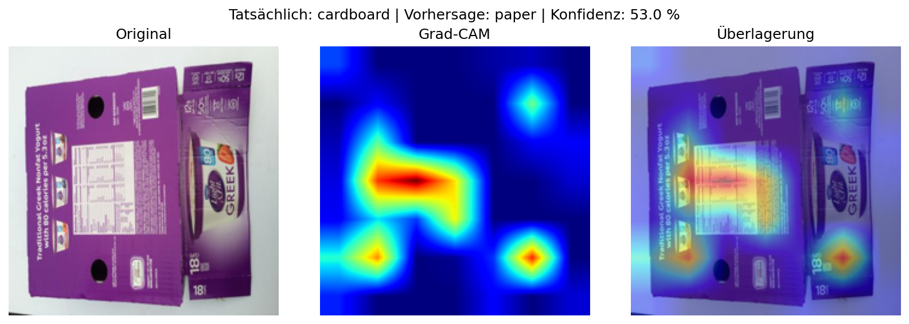

**Tatsächlich:** paper · **Vorhersage:** metal · **Konfidenz:** 32.44 % · **Ergebnis:** Falsch

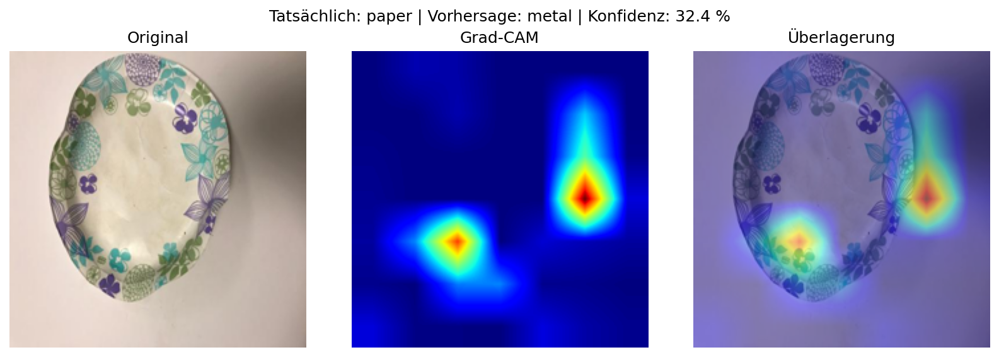

## 8. Statistische Unsicherheit

Für die Accuracy wurde ein Bootstrap mit 1000 Wiederholungen und Ziehen mit Zurücklegen durchgeführt.

**Berechnung:** In jedem Bootstrap-Durchlauf werden N Testbilder zufällig mit Zurücklegen gezogen und die Accuracy berechnet. Die Grenzen entsprechen dem 2,5. und 97,5. Perzentil der Bootstrap-Werte.

| Kennzahl | Ergebnis |
| --- | --- |
| 95-%-Bootstrap-Intervall Accuracy | 81.77 % bis 88.80 % |

Das Intervall setzt für diese Berechnung unabhängige Bilder voraus. Bei gruppenabhängigen Aufnahmen kann die Unsicherheit unterschätzt werden.

## 9. Grenzen und offene Punkte

- **Datensplit:** Der vorgegebene Testsplit wurde unverändert übernommen. Eine Prüfung der Gruppentrennung ist nicht Bestandteil dieser Evaluation.

- **OOD-Fallback:** Der 80-%-Threshold erkennt keine unbekannten Verteilungen zuverlässig. Eine sichere Standardreaktion muss noch festgelegt werden.

- **Edge-Gerät:** Laufzeitmessungen liegen nur für Colab vor. Eine Messung auf dem Zielgerät und der Vergleich mit einem Latenzbudget stehen aus.

- **Robustheit:** Die bestehenden Testbilder erlauben eine klassenbezogene Fehleranalyse. Robustheit gegenüber Beleuchtungswechsel, Hintergrundwechsel und anderen Anlagen kann damit nicht separat nachgewiesen werden.

- **Produktiver Betrieb:** Shadow Mode, Betriebsüberwachung und Rückkehrplan sind nicht implementiert.

- **Regression:** MAE, RMSE, MAPE und R² werden nicht berechnet, weil das Modell diskrete Klassen und keine kontinuierlichen Zielgrößen vorhersagt.

- **Zeitreihen/HMM:** Nicht relevant, weil einzelne Bilder ohne zeitliche Sequenzstruktur klassifiziert werden.

- **Kreuzvalidierung:** Kein erneutes Training, kein alternativer Modellkandidat und kein Modellvergleich.

## 10. Reproduzierbarkeit

| Parameter | Wert |
| --- | --- |
| Checkpoint | best_resnet50_trashnet.pth |
| Trainingsepoche | 10 |
| Gespeicherte Val-Accuracy | 0.8776595744680851 |
| Seed | 42 |
| Testsplit | https://raw.githubusercontent.com/qepuvb/DAT503-waste-classification/main/data/splits/split.csv |
| Datensatz | https://github.com/garythung/trashnet/raw/6fa2b878c6c1b4304b91109070ce0edf9279bb31/data/dataset-resized.zip |
| Eingabegröße | 224 × 224 Pixel |
| Normalisierung | ImageNet Mean / Std |

*Ende des Evaluationsberichts.*