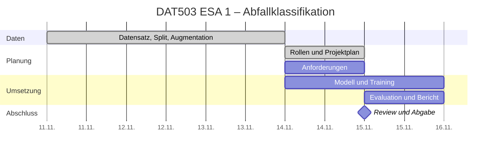

## 1. Projektplan

| Meilenstein | Verantwortlich | Frist | Status |
|---|---|---|---|
| Datensatz, Split und Augmentation | Daten und Datenqualität | Fr 13.11. | erledigt |
| Thema, Rollen und Projektplan | Projektmanagement | Sa 14.11. | erledigt |
| Anforderungen | Requirements Engineering | Sa 14.11. | offen |
| Modell trainiert | Modell und Training | So 15.11. | offen |
| Evaluation und Bericht | Evaluation, Edge und Bericht | So 15.11., Abend | offen |
| Review und Abgabe | Projektmanagement | So 15.11., 22:00 | offen |

## 2. Ressourcenzuweisung

| Rolle | Person | Verantwortung |
|---|---|---|
| Requirements Engineering | Stephanie Lepuschitz | Anforderungen und Bewertung der Technologien |
| Projektmanagement | Lucas Frank | Planung, Koordination, Monitoring, Abgabe |
| Daten und Datenqualität | Jens Mertens | Datensatz, Prüfung, Split, Augmentation |
| Modell und Training | Felix Zopf | Modell auswählen und trainieren |
| Evaluation, Edge und Bericht | Günther Reinwald | Auswertung, Edge-Betrachtung, Bericht |

Jede Person bestätigt ihre Rolle im Gruppenchat und dokumentiert ihre Arbeit selbst im Protokoll.

## 3. Kommunikationsstrategie

- Laufende Abstimmung im Gruppenchat, Probleme sofort melden.
- Kurze Status-Updates je Rolle am Samstagabend und am Sonntag (Mittag und Abend).
- Abschlussbesprechung am Sonntagabend vor der Abgabe.
- Code und Dokumente liegen im gemeinsamen GitHub-Repo.
- Wegen der kurzen Laufzeit ersetzen die Status-Updates regelmäßige wöchentliche Meetings.

## 4. Risikomanagement

| Risiko | Maßnahme |
|---|---|
| Zeitdruck durch die kurze Frist | Umfang klein halten, ein Modell, Erweiterungen nur beschreiben |
| Technische Probleme beim Training (Rechenzeit, Fehler) | Colab mit GPU nutzen, früh mit einem einfachen Lauf beginnen |
| Unausgewogene Daten (wenige Bilder in einer Klasse) | Ergebnisse je Klasse auswerten |
| Ausfall oder Verzögerung eines Teammitglieds | Verzögerungen früh melden, Aufgaben bei Bedarf umverteilen |
| Ergebnisse nicht reproduzierbar | fixe Datenquelle, fester Seed und Split, Paketversionen festhalten |

## 5. Dokumentation und Monitoring

Jede Rolle trägt ihre Tätigkeiten, Probleme und Verzögerungen in [`protokoll.md`](protokoll.md) ein. Das Projektmanagement hält bei jedem Status-Update den Gesamtstand fest:

| Zeitpunkt | Erledigt | In Arbeit | Probleme / Verzögerungen |
|---|---|---|---|
| Sa 14.11. | Datensatz, Split, Augmentation; Rollen verteilt; Projektplan | Anforderungen, Modell | knapper Zeitplan |
| Sa 14.11., Abend | | | |
| So 15.11., Mittag | | | |
| So 15.11., Abend | | | |
